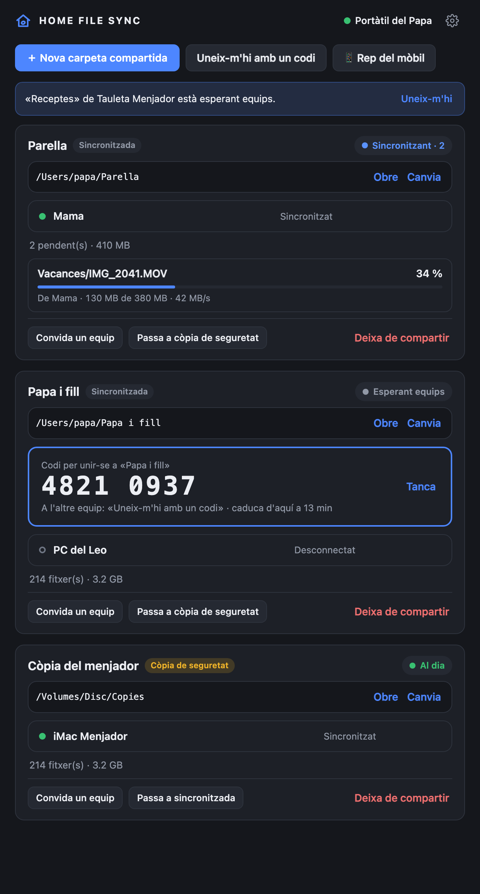
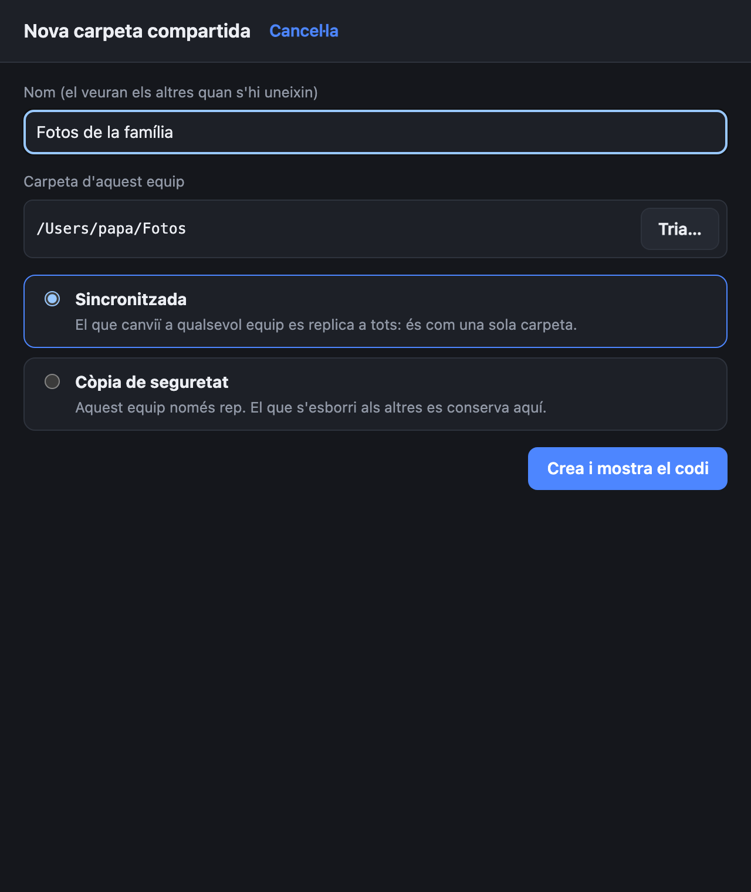
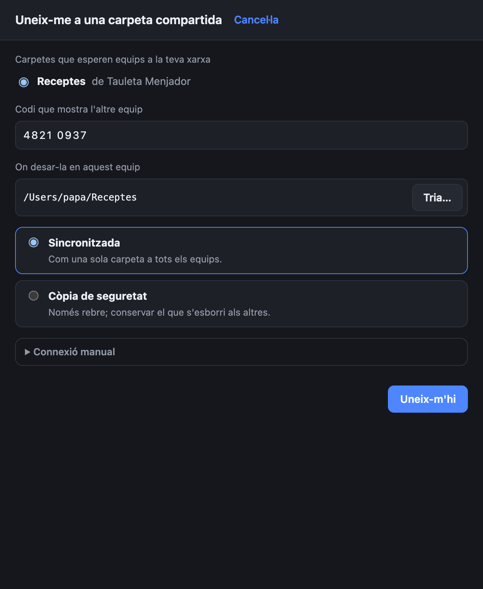
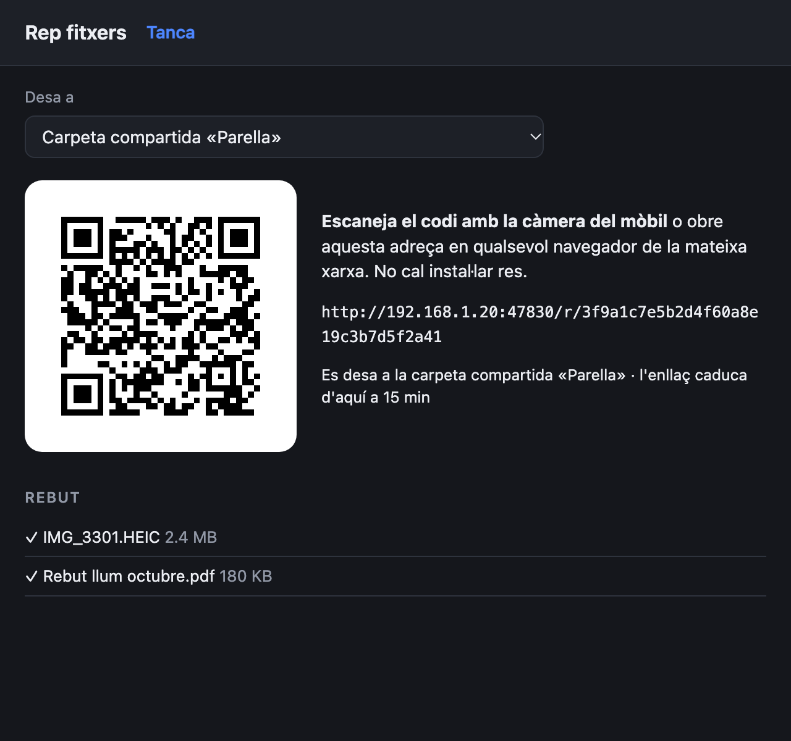
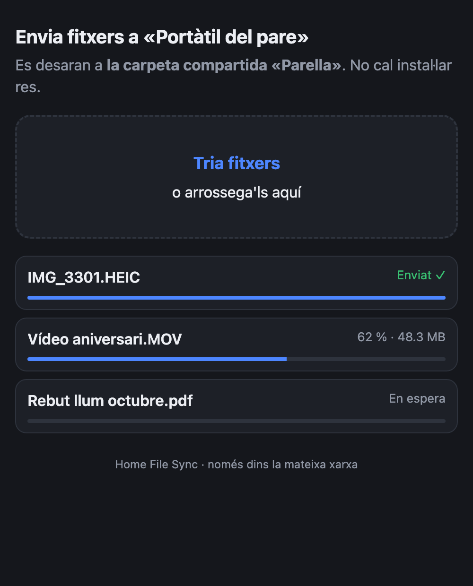
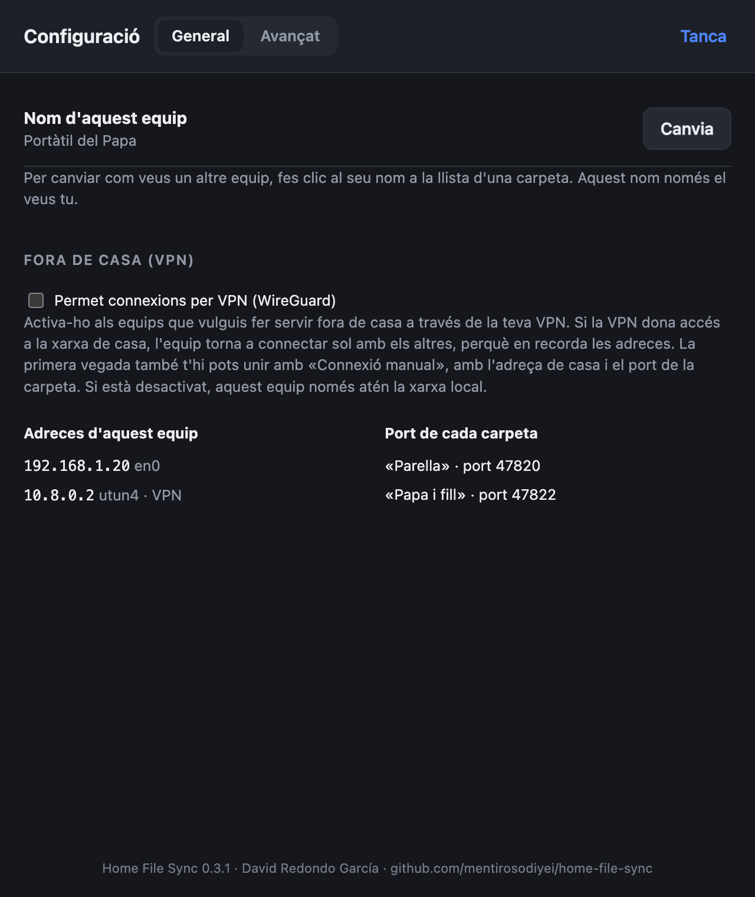

# Home File Sync

[Castellano](README.md) · **Català** · [English](README.en.md)

**Carpetes compartides entre els ordinadors de casa, a la teva pròpia xarxa.**
Windows i macOS, sense núvol, sense comptes i sense configurar adreces IP. I per enviar fotos des del mòbil n'hi ha prou amb escanejar un codi QR.

<p align="center"></p>

## Què fa

- 📁 **Carpetes compartides que funcionen com una de sola.** El que afegeixes, edites, canvies de nom o esborres en un equip apareix igual als altres.
- 👨‍👩‍👧 **Tantes carpetes com vulguis, cadascuna amb els seus membres.** Per exemple, una per a la parella, una altra entre pare i fill i una còpia de seguretat a l'ordinador del menjador. Ningú no veu les carpetes on no és.
- 💾 **Mode còpia de seguretat.** Un equip es pot limitar a rebre: els seus canvis no s'envien i el que s'esborri a l'original es conserva a la còpia.
- 🕘 **Versions anteriors.** Quan un fitxer canvia, la versió anterior es desa a la carpeta `old`, amb la data al nom.
- 📱 **Rebre des del mòbil sense instal·lar res.** L'app mostra un QR; el mòbil l'escaneja, tria les fotos o els documents i arriben a la carpeta que triïs.
- 🏷️ **Noms al teu gust.** Pots anomenar cada equip com vulguis («Anna», «PC del menjador»…). Aquest nom només el veus tu.
- 🔒 **Privat i xifrat.** Els fitxers van directament d'un equip a l'altre per la teva xarxa, xifrats; no passen per cap servidor ni per internet.
- 🌍 **També fora de casa**, a través de la teva pròpia VPN (per exemple, WireGuard).
- 🗣️ **En català, castellà i anglès**, segons l'idioma del sistema.

## Com es fa servir

### 1. Crear una carpeta compartida

Prem **Nova carpeta compartida**, posa-li un nom i tria la carpeta del teu equip. Tria també com hi participa aquest equip:
- **Sincronitzada:** el que canviï a qualsevol equip es replica a tots.
- **Còpia de seguretat:** aquest equip només rep.

En crear-la apareix un **codi de 8 xifres**, vàlid durant 15 minuts.

<p align="center"></p>

### 2. Unir-s'hi des d'un altre equip

A l'altre ordinador prem **Uneix-m'hi amb un codi**. La carpeta apareix sola, perquè els equips es detecten a la xarxa. Escriu el codi i tria on desar-la. Per afegir-hi més equips més endavant, prem **Convida un equip** a la carpeta i se'n genera un codi nou.

<p align="center"></p>

### 3. Rebre des del mòbil (o qualsevol navegador)

Prem **📱 Rep del mòbil** i tria on desar el que arribi. Escaneja el QR amb la càmera del telèfon, o obre l'adreça en qualsevol navegador connectat a la mateixa wifi:

<p align="center">
  
  &nbsp;
  
</p>

- L'enllaç caduca als 15 minuts i deixa de funcionar en tancar la finestra.
- Mai no sobreescriu un fitxer: si ja n'hi ha un amb aquest nom, desa «(2)».
- La pàgina del mòbil surt en l'idioma del telèfon.

### 4. Configuració

Des de **Configuració** es pot canviar el nom d'aquest equip i permetre les connexions per VPN, per fer servir l'app fora de casa. A **Avançat → Diagnòstic** hi ha un registre detallat de connexions que es pot filtrar, copiar i exportar.

<p align="center"></p>

En tancar la finestra, l'app continua funcionant a la **safata del sistema** (Windows) o a la **barra de menús** (macOS). Per aturar-la, tria *Surt* en aquest menú.

## Instal·lació

Baixa l'última versió a [Releases](../../releases).

| Sistema | Fitxer |
|---|---|
| macOS 11 Big Sur o posterior (Apple Silicon i Intel) | `HomeFileSync-x.y.z-macOS.dmg` |
| Windows 10 / 11 (64 bits) | `HomeFileSync-x.y.z-Windows.exe` |

**macOS**
- L'app no està signada amb un certificat de desenvolupador d'Apple. La primera vegada macOS avisarà que no la pot comprovar: ves a *Configuració del Sistema → Privacitat i seguretat* i prem **Obre igualment**.
- Quan macOS pregunti si Home File Sync pot accedir a la **xarxa local**, prem **Permet**. Sense aquest permís no podrà connectar amb els altres equips.

**Windows**
- Windows SmartScreen pot avisar perquè l'instal·lador no està signat: prem **Més informació → Executa igualment**.
- L'instal·lador afegeix les regles del Tallafoc de Windows necessàries, també per a xarxes marcades com a «Públiques».

## Com cuida els teus fitxers

- **No es perd res.**
  - Quan un fitxer canvia, la versió anterior passa a `old/` a tots els equips.
  - Si dos equips canvien el mateix fitxer alhora, es queda la versió més recent i l'altra va a `old/` com a còpia de conflicte.
  - El que s'esborra en un equip s'elimina als altres, però no s'hi destrueix: es desa 14 dies en una paperera oculta (`.homefilesync/papelera`).
- **Guanya l'edició.** Si un equip edita un fitxer mentre un altre l'esborra, el fitxer editat torna a tots.
- **Res a mitges.**
  - No es copien fitxers que encara s'estan escrivint.
  - Cada fitxer es verifica amb la seva empremta digital (BLAKE3) abans de col·locar-lo.
  - Si la xarxa es talla a mig fitxer gran, la còpia continua on s'havia quedat.
- **Discos desconnectats.** Si una carpeta desapareix o queda buida perquè s'ha desconnectat un disc, no s'esborra res als altres equips.
- **Seguretat.**
  - Només els equips que coneixen el codi s'hi poden unir. El codi no viatja per la xarxa (s'usa SPAKE2) i es bloqueja després de 5 intents fallits.
  - Les connexions van xifrades (protocol Noise).
  - Ningú no pot llegir ni escriure fora de la carpeta compartida, i els fitxers rebuts no s'executen mai.

## Xarxa

- Tots els equips han de ser a la **mateixa xarxa local**. Funciona sense internet.
- Algunes wifis d'hotels o de convidats aïllen els equips entre ells; l'app ho indica a la pantalla.
- Si una carpeta no apareix en unir-s'hi, a «Uneix-m'hi amb un codi» hi ha una **Connexió manual** per escriure l'adreça de l'altre equip.
- **Fora de casa:** amb una VPN que arribi a la xarxa de casa (WireGuard o una altra), activa *Configuració → Permet connexions per VPN* i el portàtil continuarà sincronitzant.
- Ports: 47820 (TCP, la primera carpeta; cadascuna de les altres fa servir un port lliure), 47821 (UDP, detecció), 5353 (mDNS) i 47830 (TCP, recepció des del mòbil).

La recepció des del mòbil fa servir HTTP sense xifrar dins de la xarxa de casa, perquè els navegadors no accepten sense avisos un certificat propi. No la facis servir en wifis públiques.

Més detalls (en castellà) a [docs/RED.md](docs/RED.md) i [docs/ARQUITECTURA.md](docs/ARQUITECTURA.md).

## Compilar des del codi

Requisits: [Rust](https://rustup.rs) estable i Node.js, que només cal per a l'eina d'empaquetatge de Tauri.

```bash
cargo test --workspace
```

```bash
cargo run -p home-file-sync
```

Instal·ladors (macOS universal i, des d'un Mac, també el de Windows):

```bash
scripts/compilar-macos.sh --publico
```

```bash
scripts/compilar-windows-desde-mac.sh
```

```bash
scripts/publicar-instaladores.sh
```

`scripts/capturas.sh` regenera les captures d'aquests README, en els tres idiomes, amb dades d'exemple.

### Estructura

```
crates/sfs-core   motor: detecció, aparellament, sincronització, hub, recepció web, traduccions
crates/sfs-cli    versió sense interfície (diagnòstic i proves)
app/src-tauri     aplicació d'escriptori (Tauri 2)
app/ui            interfície (HTML/CSS/JS sense dependències)
docs/             arquitectura, xarxa i captures
```

## Llicència

MIT o Apache-2.0, a la teva elecció. Historial de canvis (en castellà) a [CHANGELOG.md](CHANGELOG.md).
