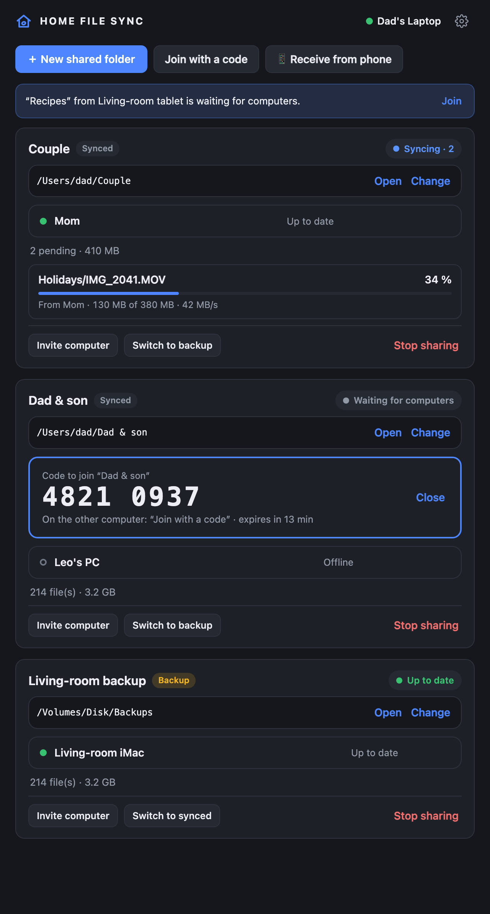
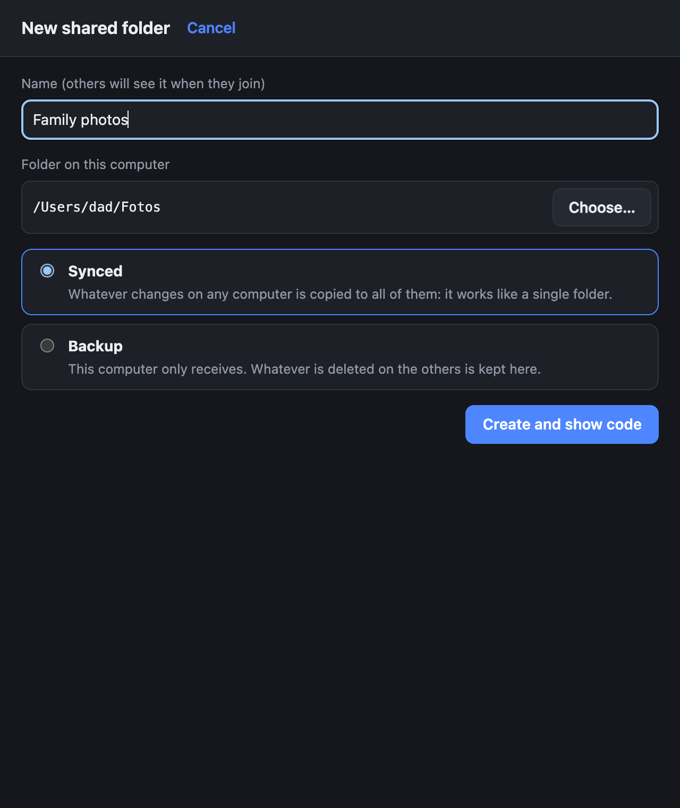
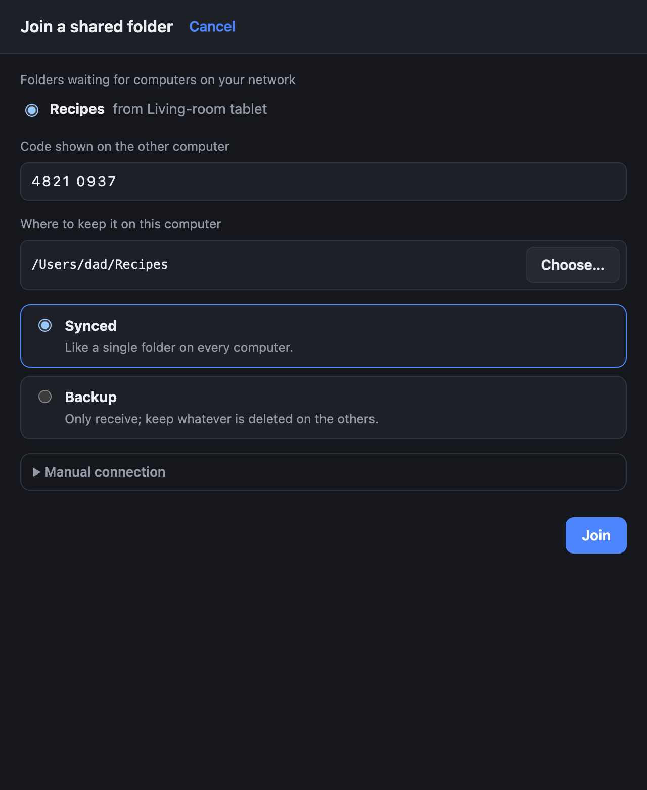
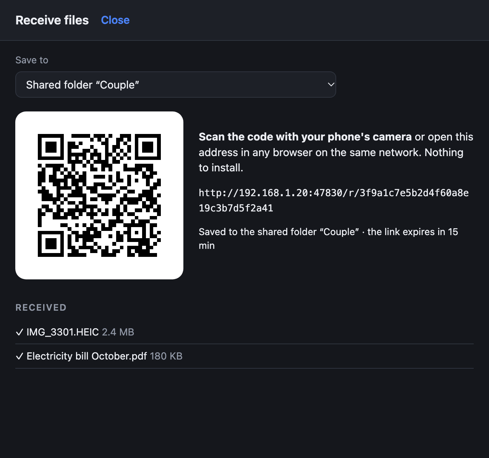
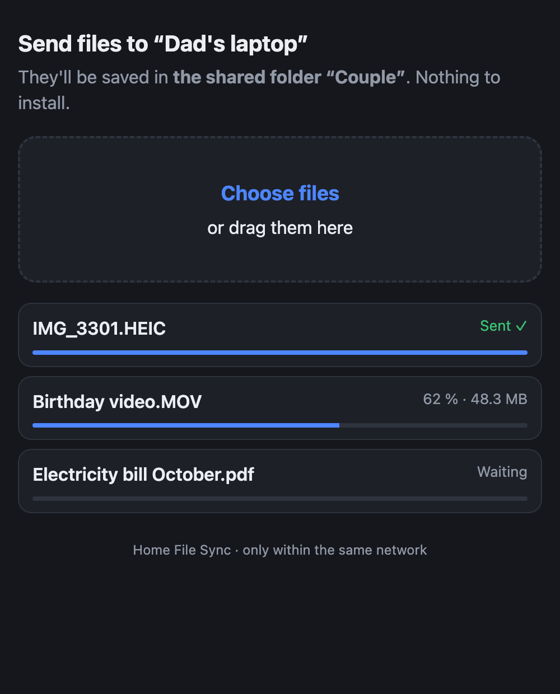
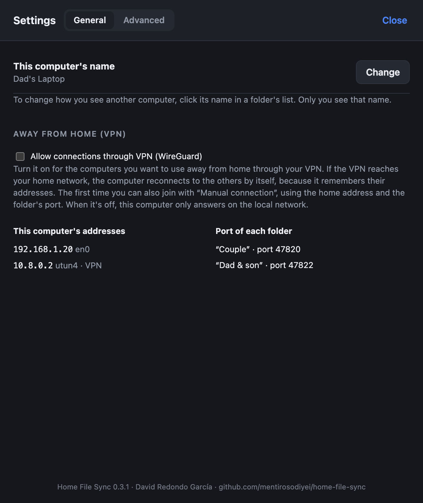

# Home File Sync

[Castellano](README.md) · [Català](README.ca.md) · **English**

**Shared folders between the computers at home, on your own network.**
Windows and macOS, no cloud, no accounts and no IP addresses to configure. To send photos from your phone, just scan a QR code.

<p align="center"></p>

## What it does

- 📁 **Shared folders that work as one.** Whatever you add, edit, rename or delete on one computer shows up the same on the others.
- 👨‍👩‍👧 **As many folders as you like, each with its own members.** For example, one for you and your partner, another between parent and child, and a backup on the living-room computer. Nobody sees the folders they aren't in.
- 💾 **Backup mode.** A computer can just receive: its changes aren't sent, and whatever is deleted on the original is kept in the backup.
- 🕘 **Previous versions.** When a file changes, the previous version is saved in the `old` folder, with the date in its name.
- 📱 **Receive from your phone without installing anything.** The app shows a QR code; the phone scans it, picks photos or documents, and they arrive in the folder you chose.
- 🏷️ **Your own names.** You can call each computer whatever you like ("Ana", "Living-room PC"…). Only you see that name.
- 🔒 **Private and encrypted.** Files go straight from one computer to another over your network, encrypted; they never go through a server or the internet.
- 🌍 **Away from home too**, through your own VPN (for example, WireGuard).
- 🗣️ **In English, Catalan and Spanish**, following the system language.

## How to use it

### 1. Create a shared folder

Click **New shared folder**, give it a name and choose the folder on your computer. Also choose how this computer takes part:
- **Synced:** whatever changes on any computer is copied to all of them.
- **Backup:** this computer only receives.

Once created, an **8-digit code** appears, valid for 15 minutes.

<p align="center"></p>

### 2. Join from another computer

On the other computer click **Join with a code**. The folder appears by itself, because computers discover each other on the network. Type the code and choose where to keep it. To add more computers later, click **Invite computer** on the folder and a new code is generated.

<p align="center"></p>

### 3. Receive from your phone (or any browser)

Click **📱 Receive from phone** and choose where incoming files go. Scan the QR code with the phone's camera, or open the address in any browser on the same Wi-Fi:

<p align="center">
  
  &nbsp;
  
</p>

- The link expires after 15 minutes and stops working when the window is closed.
- It never overwrites a file: if one with that name already exists, it saves "(2)".
- The phone page follows the phone's language.

### 4. Settings

In **Settings** you can change this computer's name and allow VPN connections, to use the app away from home. **Advanced → Diagnostics** has a detailed connection log you can filter, copy and export.

<p align="center"></p>

When you close the window, the app keeps running in the **system tray** (Windows) or the **menu bar** (macOS). To stop it, choose *Quit* in that menu.

## Installation

Download the latest version from [Releases](../../releases).

| System | File |
|---|---|
| macOS 11 Big Sur or later (Apple Silicon and Intel) | `HomeFileSync-x.y.z-macOS.dmg` |
| Windows 10 / 11 (64-bit) | `HomeFileSync-x.y.z-Windows.exe` |

**macOS**
- The app isn't signed with an Apple developer certificate. The first time, macOS will say it can't verify it: go to *System Settings → Privacy & Security* and click **Open Anyway**.
- When macOS asks whether Home File Sync may access the **local network**, click **Allow**. Without that permission it can't connect to the other computers.

**Windows**
- Windows SmartScreen may warn you because the installer isn't signed: click **More info → Run anyway**.
- The installer adds the Windows Firewall rules it needs, including for networks marked "Public".

## How it takes care of your files

- **Nothing is lost.**
  - When a file changes, the previous version moves to `old/` on every computer.
  - If two computers change the same file at the same time, the newest version wins and the other goes to `old/` as a conflict copy.
  - What is deleted on one computer is removed on the others, but not destroyed there: it is kept for 14 days in a hidden trash (`.homefilesync/papelera`).
- **The edit wins.** If one computer edits a file while another deletes it, the edited file comes back everywhere.
- **Nothing half-done.**
  - Files that are still being written aren't copied.
  - Every file is checked with its fingerprint (BLAKE3) before it is put in place.
  - If the network drops halfway through a large file, the copy resumes where it left off.
- **Disconnected drives.** If a folder disappears or becomes empty because a drive was unplugged, nothing is deleted on the other computers.
- **Security.**
  - Only computers that know the code can join. The code never travels over the network (SPAKE2 is used) and is locked after 5 failed attempts.
  - Connections are encrypted (Noise protocol).
  - Nobody can read or write outside the shared folder, and received files are never run.

## Network

- All computers must be on the **same local network**. It works without internet.
- Some hotel or guest Wi-Fi networks isolate devices from each other; the app tells you so on screen.
- If a folder doesn't appear when joining, **Join with a code** has a **Manual connection** option to type the other computer's address.
- **Away from home:** with a VPN that reaches your home network (WireGuard or another), turn on *Settings → Allow connections through VPN* and the laptop keeps syncing.
- Ports: 47820 (TCP, the first folder; each of the others uses a free port), 47821 (UDP, discovery), 5353 (mDNS) and 47830 (TCP, receiving from the phone).

Receiving from the phone uses unencrypted HTTP inside your home network, because browsers don't accept a self-made certificate without warnings. Don't use it on public Wi-Fi.

More details (in Spanish) in [docs/RED.md](docs/RED.md) and [docs/ARQUITECTURA.md](docs/ARQUITECTURA.md).

## Building from source

Requirements: stable [Rust](https://rustup.rs) and Node.js, which is only needed for the Tauri packaging tool.

```bash
cargo test --workspace
```

```bash
cargo run -p home-file-sync
```

Installers (universal macOS and, from a Mac, Windows too):

```bash
scripts/compilar-macos.sh --publico
```

```bash
scripts/compilar-windows-desde-mac.sh
```

```bash
scripts/publicar-instaladores.sh
```

`scripts/capturas.sh` regenerates the screenshots in these READMEs, in all three languages, with sample data.

### Layout

```
crates/sfs-core   engine: discovery, pairing, sync, hub, web receiving, translations
crates/sfs-cli    headless version (diagnostics and tests)
app/src-tauri     desktop app (Tauri 2)
app/ui            interface (HTML/CSS/JS, no dependencies)
docs/             architecture, network and screenshots
```

## License

MIT or Apache-2.0, at your option. Change history (in Spanish) in [CHANGELOG.md](CHANGELOG.md).
