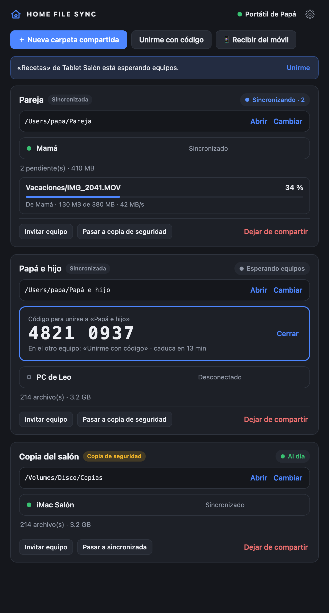
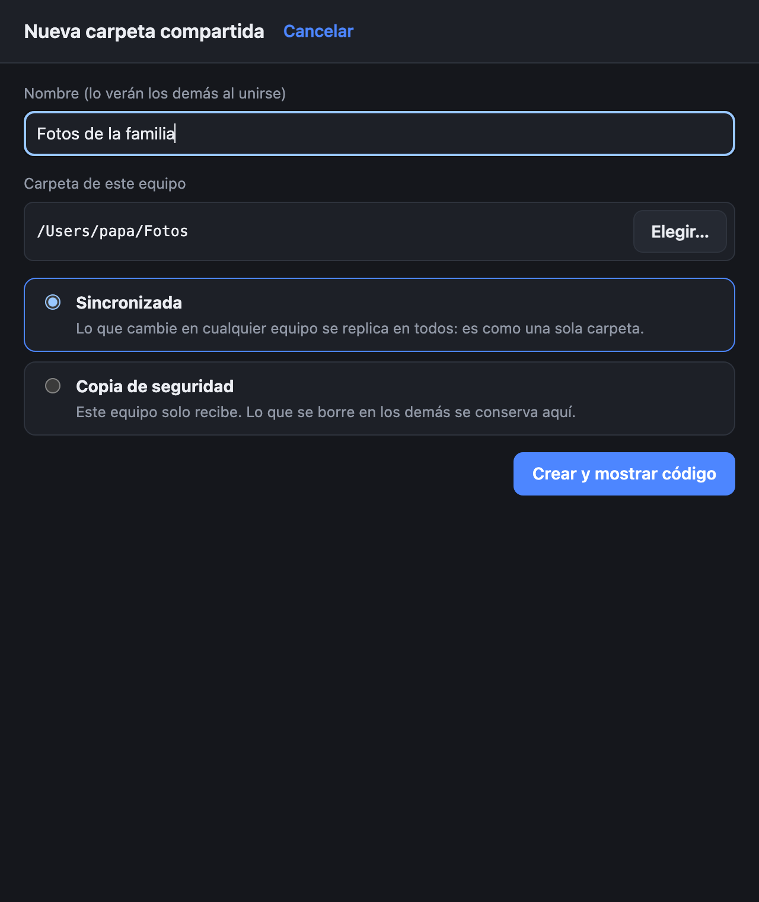
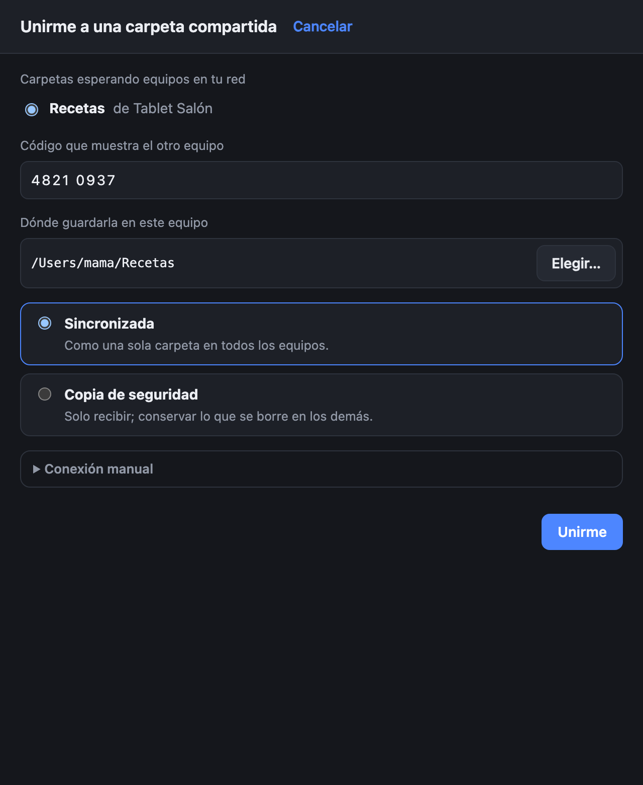
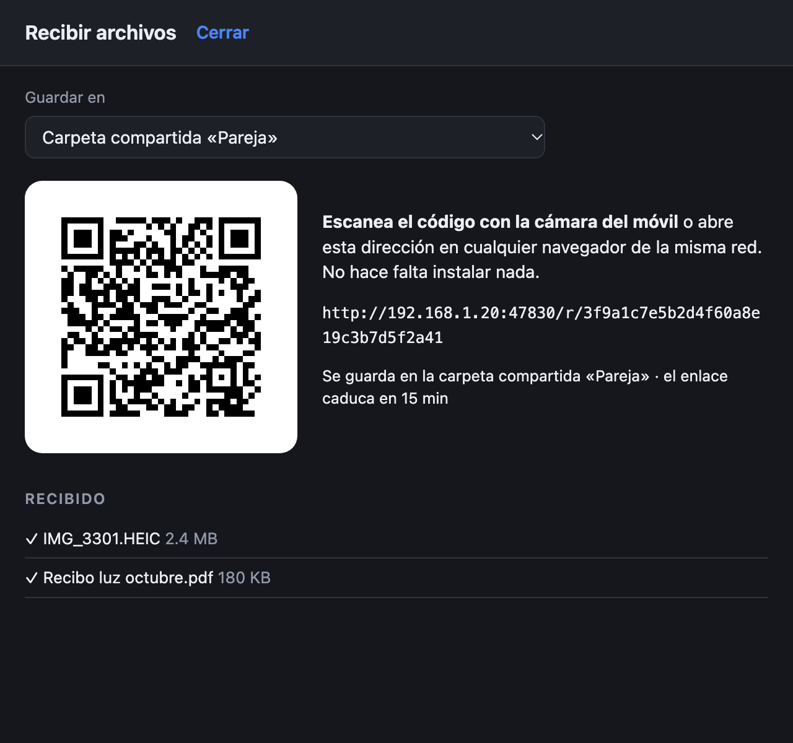
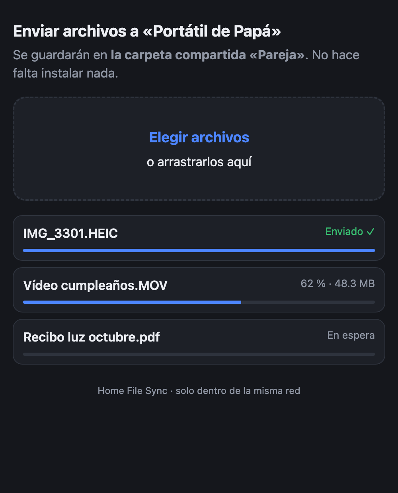
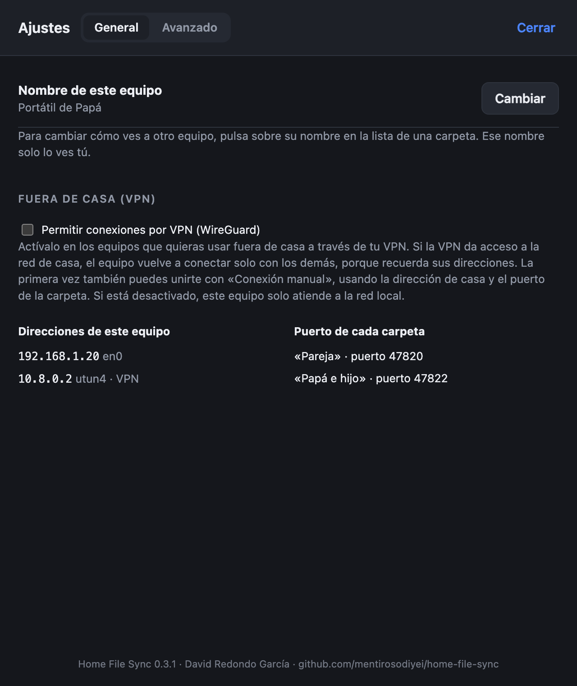

# Home File Sync

**Carpetas compartidas entre los ordenadores de casa, en tu propia red.**
Windows y macOS, sin nube, sin cuentas y sin configurar direcciones IP. Y para enviar fotos desde el móvil basta con escanear un código QR.

<p align="center"></p>

## Qué hace

- 📁 **Carpetas compartidas que funcionan como una sola.** Lo que añades, editas, renombras o borras en un equipo aparece igual en los demás.
- 👨‍👩‍👧 **Tantas carpetas como quieras, cada una con sus miembros.** Por ejemplo, una para la pareja, otra entre padre e hijo y una copia de seguridad en el ordenador del salón. Nadie ve las carpetas en las que no está.
- 💾 **Modo copia de seguridad.** Un equipo puede limitarse a recibir: sus cambios no se envían y lo que se borre en el original se conserva en la copia.
- 🕘 **Versiones anteriores.** Cuando un archivo cambia, la versión anterior se guarda en la carpeta `old`, con la fecha en el nombre.
- 📱 **Recibir desde el móvil sin instalar nada.** La app muestra un QR; el móvil lo escanea, elige las fotos o documentos y llegan a la carpeta que elijas.
- 🏷️ **Nombres a tu gusto.** Puedes llamar a cada equipo como quieras («Ana», «PC del salón»…). Ese nombre solo lo ves tú.
- 🔒 **Privado y cifrado.** Los archivos van directamente de un equipo a otro por tu red, cifrados; no pasan por ningún servidor ni por internet.
- 🌍 **También fuera de casa**, a través de tu propia VPN (por ejemplo, WireGuard).

## Cómo se usa

### 1. Crear una carpeta compartida

Pulsa **Nueva carpeta compartida**, ponle un nombre y elige la carpeta de tu equipo. Elige también cómo participa este equipo:
- **Sincronizada:** lo que cambie en cualquier equipo se replica en todos.
- **Copia de seguridad:** este equipo solo recibe.

Al crearla aparece un **código de 8 cifras**, válido 15 minutos.

<p align="center"></p>

### 2. Unirse desde otro equipo

En el otro ordenador pulsa **Unirme con código**. La carpeta aparece sola, porque los equipos se descubren en la red. Escribe el código y elige dónde guardarla. Para añadir más equipos más adelante, pulsa **Invitar equipo** en la carpeta y se genera un código nuevo.

<p align="center"></p>

### 3. Recibir desde el móvil (o cualquier navegador)

Pulsa **📱 Recibir del móvil** y elige dónde guardar lo que llegue. Escanea el QR con la cámara del teléfono, o abre la dirección en cualquier navegador conectado a la misma wifi:

<p align="center">
  
  &nbsp;
  
</p>

- El enlace caduca a los 15 minutos y deja de funcionar al cerrar la ventana.
- Nunca sobrescribe un archivo: si ya existe uno con ese nombre, guarda «(2)».

### 4. Ajustes

Desde **Ajustes** se puede cambiar el nombre de este equipo y permitir las conexiones por VPN, para usar la app fuera de casa. En **Avanzado → Diagnóstico** hay un registro detallado de conexiones que se puede filtrar, copiar y exportar.

<p align="center"></p>

Al cerrar la ventana, la app sigue funcionando en la **bandeja del sistema** (Windows) o en la **barra de menús** (macOS). Para detenerla, elige *Salir* en ese menú.

## Instalación

Descarga la última versión en [Releases](../../releases).

| Sistema | Archivo |
|---|---|
| macOS 11 Big Sur o posterior (Apple Silicon e Intel) | `HomeFileSync-x.y.z-macOS.dmg` |
| Windows 10 / 11 (64 bits) | `HomeFileSync-x.y.z-Windows.exe` |

**macOS**
- La app no está firmada con un certificado de desarrollador de Apple. La primera vez macOS avisará de que no puede comprobarla: ve a *Ajustes del Sistema → Privacidad y seguridad* y pulsa **Abrir igualmente**.
- Cuando macOS pregunte si Home File Sync puede acceder a la **red local**, pulsa **Permitir**. Sin ese permiso no podrá conectar con los demás equipos.

**Windows**
- Windows SmartScreen puede avisar porque el instalador no está firmado: pulsa **Más información → Ejecutar de todas formas**.
- El instalador añade las reglas del Firewall de Windows necesarias, también para redes marcadas como «Públicas».

## Cómo cuida tus archivos

- **No se pierde nada.**
  - Cuando un archivo cambia, la versión anterior pasa a `old/` en todos los equipos.
  - Si dos equipos cambian el mismo archivo a la vez, se queda la versión más reciente y la otra va a `old/` como copia de conflicto.
  - Lo que se borra en un equipo se elimina en los demás, pero en ellos no se destruye: se guarda 14 días en una papelera oculta (`.homefilesync/papelera`).
- **Gana la edición.** Si un equipo edita un archivo mientras otro lo borra, el archivo editado vuelve a todos.
- **Nada a medias.**
  - No se copian archivos que todavía se están escribiendo.
  - Cada archivo se verifica con su huella digital (BLAKE3) antes de colocarlo.
  - Si se corta la red a mitad de un archivo grande, la copia continúa donde se quedó.
- **Discos desconectados.** Si una carpeta desaparece o queda vacía porque se desconectó un disco, no se borra nada en los demás equipos.
- **Seguridad.**
  - Solo los equipos que conocen el código pueden unirse. El código no viaja por la red (se usa SPAKE2) y se bloquea tras 5 intentos fallidos.
  - Las conexiones van cifradas (protocolo Noise).
  - Nadie puede leer ni escribir fuera de la carpeta compartida, y los archivos recibidos nunca se ejecutan.

## Red

- Todos los equipos deben estar en la **misma red local**. Funciona sin internet.
- Algunas wifi de hoteles o de invitados aíslan a los equipos entre sí; la app lo indica en pantalla.
- Si una carpeta no aparece al unirse, en «Unirme con código» hay una **Conexión manual** para escribir la dirección del otro equipo.
- **Fuera de casa:** con una VPN que llegue a la red de casa (WireGuard u otra), activa *Ajustes → Permitir conexiones por VPN* y el portátil seguirá sincronizando.
- Puertos: 47820 (TCP, la primera carpeta; cada una de las demás usa un puerto libre), 47821 (UDP, descubrimiento), 5353 (mDNS) y 47830 (TCP, recepción desde el móvil).

La recepción desde el móvil usa HTTP sin cifrar dentro de la red de casa, porque los navegadores no aceptan sin avisos un certificado propio. No la uses en wifis públicas.

Más detalles en [docs/RED.md](docs/RED.md) y [docs/ARQUITECTURA.md](docs/ARQUITECTURA.md).

## Compilar desde el código

Requisitos: [Rust](https://rustup.rs) estable y Node.js, que solo hace falta para la herramienta de empaquetado de Tauri.

```bash
cargo test --workspace
```

```bash
cargo run -p home-file-sync
```

Instaladores (macOS universal y, desde un Mac, también el de Windows):

```bash
scripts/compilar-macos.sh --publico
```

```bash
scripts/compilar-windows-desde-mac.sh
```

```bash
scripts/publicar-instaladores.sh
```

`scripts/capturas.sh` regenera las capturas de este README con datos de ejemplo.

### Estructura

```
crates/sfs-core   motor: descubrimiento, emparejamiento, sincronización, hub, recepción web
crates/sfs-cli    versión sin interfaz (diagnóstico y pruebas)
app/src-tauri     aplicación de escritorio (Tauri 2)
app/ui            interfaz (HTML/CSS/JS sin dependencias)
docs/             arquitectura, red y capturas
```

## Licencia

MIT o Apache-2.0, a tu elección. Historial de cambios en [CHANGELOG.md](CHANGELOG.md).
